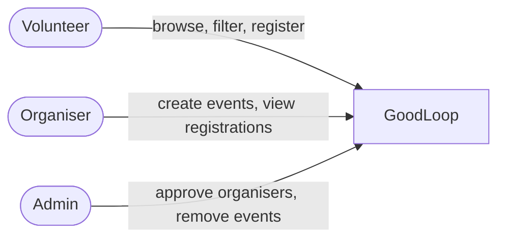
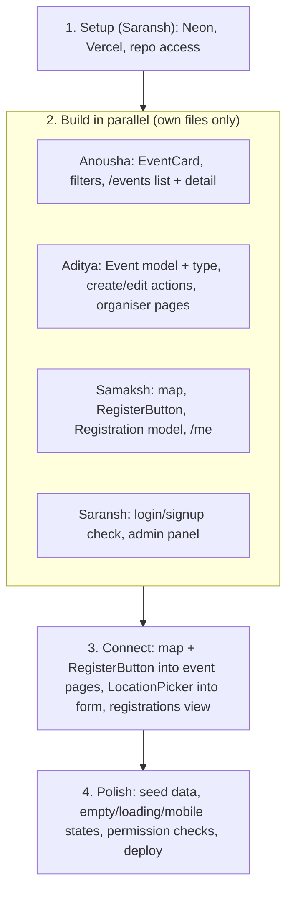

# GoodLoop

Volunteering discovery platform (Next.js App Router, TypeScript, Prisma, Auth.js, Tailwind + shadcn/ui, Leaflet).
Team rules, file ownership and contracts: see `../WORK_SPLIT.md`.

## About the project
GoodLoop connects volunteers with local volunteering opportunities.
- **Volunteers** browse and filter events (by cause, date, location), see them on a map, and register interest.
- **Organisers** create and manage their events and see who registered. They must be approved by an admin first.
- **Admins** approve organisers and remove inappropriate events.



## Order of work
Everyone starts at once, using fake data and the stub exports, so nobody waits on anybody.

Tasks, owners and checklists are in the [GitHub issues](https://github.com/Saransh-Jainbu/goodloop/issues) and on the [project board](https://github.com/users/Saransh-Jainbu/projects/4). File ownership and contracts: `CLAUDE.md` and `../WORK_SPLIT.md`.

## Setup

```bash
pnpm install
cp .env.example .env           # (Prisma + Next both read .env) fill DATABASE_URL, DIRECT_URL (Neon) and AUTH_SECRET
pnpm prisma migrate dev --name init
pnpm db:seed                   # admin + demo organiser
pnpm dev
```

Seeded logins: `admin@goodloop.test` / `change-me-123`, `organiser@goodloop.test` / `organiser-123` (dev only).

## Database (Neon)
- Prod/shared DB lives on Neon. `DATABASE_URL` = pooled connection string (host has `-pooler`); `DIRECT_URL` = direct one, used by `prisma migrate`.
- Each dev should use their **own Neon branch** (Neon console -> Branches -> Create) so migrations don't collide while developing; only `main` runs against the shared branch. Set the Vercel env vars for production to the `main` branch's strings.

## Deployment (Vercel)
Owner: Saransh. Vercel project is linked to the GitHub repo; `main` auto-deploys to production, every PR gets a preview URL.
1. Import the repo in Vercel (framework: Next.js; it picks up pnpm from `packageManager` and runs the `vercel-build` script).
2. Env vars (Project Settings -> Environment Variables): `DATABASE_URL` (pooled), `DIRECT_URL` (direct), `AUTH_SECRET`, `AUTH_URL` (the production URL). Never reuse the production values for Preview.
3. Database: install the **Neon integration** in Vercel so each Preview deployment gets its own Neon branch automatically; Production uses the main Neon branch.
4. Migrations: `vercel-build` runs `prisma migrate deploy` **only** when `VERCEL_ENV=production`, so previews never touch the production schema. Commit migration folders; never run `migrate dev` against production.
5. Keep `main` deployable: a failing build blocks the deploy, so run `pnpm lint && pnpm typecheck && pnpm build` before opening a PR.

## CI & pull requests
- `.github/workflows/ci.yml` runs on every PR to `main`: `prisma validate`, `pnpm lint`, `pnpm typecheck`, `next build` (dummy env, no DB needed).
- In GitHub branch protection for `main`, require the **Lint, typecheck, build** check plus 1 approval and code-owner review.
- PRs use `.github/pull_request_template.md`; fill every checkbox honestly.

## Scripts
`dev`, `build`, `lint`, `typecheck`, `db:migrate`, `db:studio`, `db:seed`


