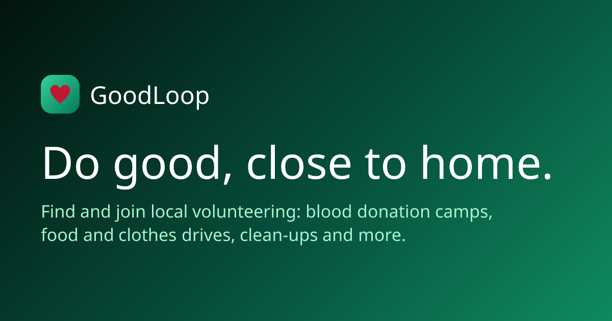

<div align="center">

# GoodLoop

**Do good, close to home.**

Find and join local volunteering opportunities: blood donation camps, food and clothes drives, clean-ups, teaching sessions and more. Organisers list events and see who is coming; volunteers register in one click; admins keep it safe.

[**Live site**](https://goodloop-pi.vercel.app) · [Browse events](https://goodloop-pi.vercel.app/events) · [Roadmap](https://github.com/Saransh-Jainbu/goodloop/issues/61) · [Report a bug](https://github.com/Saransh-Jainbu/goodloop/issues/new)

[](https://github.com/Saransh-Jainbu/goodloop/actions/workflows/ci.yml)



</div>

## What it does

Local welfare drives are advertised through scattered chat groups and posters, so volunteers can't find them and organisers can't tell who will show up. GoodLoop puts them in one place.

| Who | What they can do |
|---|---|
| **Volunteers** | Browse and search events, filter by cause, date and location, see them on a map, register interest with one click, manage their registrations and profile |
| **Organisers** | Create and manage events (draft, publish, cancel, duplicate), pin them on a map, see and export who registered. Approved by an admin first |
| **Admins** | Approve or reject organisers, remove inappropriate events, see platform stats and search users |

**Features**
- Event discovery with keyword search, cause and date filters, sorting (soonest, newest, recommended) and pagination, all in the URL so any search is a shareable link
- Interactive map (OpenStreetMap) with event popups, and a click-to-pin location picker for organisers
- One-click registration with capacity limits, plus an add-to-calendar download for each event
- Role-based access (volunteer, organiser, admin) enforced on the server
- Responsive, accessible interface with a mobile menu

**Coming next:** organisations people can create and join, announcements, members-only chat, and welfare drives with goals. See the [plan](docs/PLAN_ORGANISATIONS.md) and the [roadmap issue](https://github.com/Saransh-Jainbu/goodloop/issues/61).

## Tech stack

Next.js 15 (App Router) · TypeScript · PostgreSQL on Neon · Prisma 6 · Auth.js v5 · Tailwind CSS and shadcn/ui · Leaflet and OpenStreetMap · zod · Vitest · deployed on Vercel.

## Getting started

You need Node 22, [pnpm](https://pnpm.io) and a PostgreSQL database. Use **your own Neon branch**, never the shared production database.

```bash
git clone https://github.com/Saransh-Jainbu/goodloop.git
cd goodloop
pnpm install
cp .env.example .env        # fill in the values below
pnpm prisma migrate deploy  # applies the committed migrations to your database
pnpm db:seed                # demo organiser, admin and sample events
pnpm dev                    # http://localhost:3000
```

| Variable | What it is |
|---|---|
| `DATABASE_URL` | Pooled Postgres connection string (the host contains `-pooler`), used by the app |
| `DIRECT_URL` | Direct connection string to the same database, used for migrations |
| `AUTH_SECRET` | Random secret for sessions: `openssl rand -base64 32` |
| `AUTH_URL` | The site's public URL, e.g. `http://localhost:3000`. Also used for sitemap and share links |
| `SEED_ADMIN_PASSWORD`, `SEED_ORGANISER_PASSWORD` | Passwords for the seeded accounts. If empty, the seed generates random ones and prints them once |

There are no default passwords. To change any account's password, run `pnpm db:set-password <email>`: it asks in your terminal, so the password never appears in history or logs.

### Scripts

`pnpm dev` · `pnpm build` · `pnpm lint` · `pnpm typecheck` · `pnpm test` · `pnpm db:migrate` · `pnpm db:seed` · `pnpm db:set-password <email>` · `pnpm db:studio`

## Project structure

```
src/app/            pages and routes (events, organiser, admin, me, auth)
src/features/       feature code: discovery, events, registrations, map, admin, auth
src/components/     shared UI (design system, navbar, landing page)
src/lib/            auth, database, session helpers
prisma/schema/      database models, one file per area, plus committed migrations
docs/               project report and the organisations plan
```

## Contributing

- Work on a branch named `yourname/short-task` and open a pull request into `main`. CI (prisma validate, lint, typecheck, unit tests, build) must pass and one review is required.
- One owner per area: see [`.github/CODEOWNERS`](.github/CODEOWNERS) and [`CLAUDE.md`](CLAUDE.md) for ownership, contracts between areas and conventions.
- Keep PRs small, validate every Server Action input with zod, enforce permissions on the server, and never commit `.env*` or secrets.
- Migrations: only for your own `prisma/schema/*.prisma` file; never edit an existing migration.

## Deployment

`main` deploys to Vercel automatically and every pull request gets a preview. Set `DATABASE_URL`, `DIRECT_URL`, `AUTH_SECRET` and `AUTH_URL` in the Vercel project settings; production runs `prisma migrate deploy` on each deploy. Never run `migrate dev` against production.

## Documentation

- [Project report](docs/PROJECT_REPORT.md): requirements, architecture, data design, testing and status
- [Organisations platform plan](docs/PLAN_ORGANISATIONS.md): roles, permissions, data model and phases
