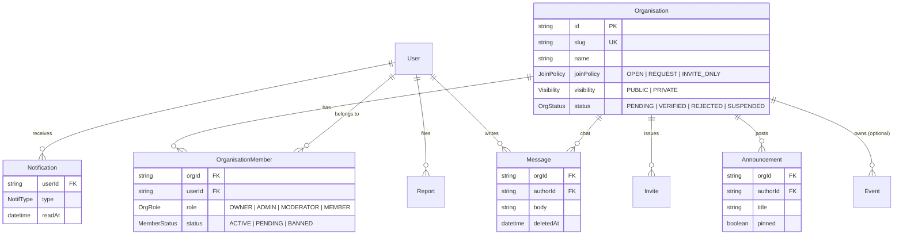

# GoodLoop Organisations Platform: Plan

Status: **proposal, needs team sign-off** (see issue #62). Tracking issue: #61.

## 1. Vision

GoodLoop grows from "browse volunteering events" into a platform for social-welfare communities, in the spirit of Luma but for good causes: blood-donation camps, food and clothes drives, clean-ups, teaching, and more.

- **Organisations** (an NGO, a college club, a blood bank) have a public profile and a team.
- **People join** organisations, openly, by request, or by invite.
- **Organisation admins** announce news to their members.
- **Members chat** in a members-only channel.
- **Events and drives** live under an organisation, so members see them first and admins manage them as a team.
- Volunteers can still browse and register for events without joining anything.

> **Scope warning.** `CLAUDE.md` says the MVP is small on purpose. This roughly doubles the app. Agree it as a team first (#62); if time is short, ship phases 1 and 2 well and treat chat as a stretch.

## 2. Working assumptions (to confirm in #62)

| Question | Assumption |
|---|---|
| Who can create an organisation? | Any signed-in user; it stays hidden until a platform admin verifies it |
| How do people join? | Per organisation: Open, Request to join, or Invite only |
| Chat scope | One members-only channel per organisation. No direct messages or event chats yet |
| Notifications | In-app first; email in phase 5 |
| Chat transport | Polling every few seconds (no new infrastructure); swappable later |
| Existing organisers and events | Keep working; events may belong to an organisation or stay independent |
| Final evaluation date | **Unknown. Needed to decide how many phases fit** |

## 3. Roles and permissions

Two separate role systems:

- **Platform role** (existing): Volunteer (`USER`), Organiser (`ORGANISER`), Admin (`ADMIN`).
- **Organisation role** (new): Owner, Admin, Moderator, Member.

| Action | Visitor | Member | Moderator | Org admin | Owner | Platform admin |
|---|---|---|---|---|---|---|
| View a public, verified org profile | yes | yes | yes | yes | yes | yes |
| Join (policy Open) or request (policy Request) | log in first | n/a | n/a | n/a | n/a | n/a |
| Read announcements | public orgs only | yes | yes | yes | yes | yes |
| Read and send chat | no | yes | yes | yes | yes | read only, for moderation |
| Report content | no | yes | yes | yes | yes | yes |
| Delete any chat message, mute, ban from chat | no | no | yes | yes | yes | yes |
| Post, edit, pin announcements | no | no | no | yes | yes | no |
| Create and manage the org's events | no | no | no | yes | yes | no |
| Approve join requests, manage invites | no | no | no | yes | yes | no |
| Change member roles (up to Moderator) | no | no | no | yes | yes | no |
| Create Org admins | no | no | no | no | yes | no |
| Edit org settings | no | no | no | yes | yes | no |
| Transfer ownership, archive org | no | no | no | no | yes | no |
| Verify, reject, suspend an org | no | no | no | no | no | yes |

Rules: the last Owner can't be demoted, removed or banned; nobody changes their own role; banned and pending people never count as members; a moderator can't act on an admin or owner.

This table is the specification for the permission tests in #65.

## 4. Data model (new, additive)

Also: `Invite`, `ChatRead`, `Report`, `AuditLog`, and a nullable `Event.organisationId`. The new tables go in `prisma/schema/organisation.prisma`. All changes are additive, and existing events and users keep working.

## 5. Key technical decisions

**Permissions go through one set of helpers.** `requireOrgRole(orgId, minRole)` and friends (#65) are the only place org roles are checked, mirroring `requireRole` for platform roles. Server actions never check roles inline. Every cell of the matrix above becomes a test.

**Chat transport.** Vercel serverless functions can't hold WebSocket connections. Options:

| Option | Cost | Verdict |
|---|---|---|
| Polling every 3 to 5 s while the tab is visible | none | **Start here.** Works today, fine at capstone scale |
| Managed pub/sub (Pusher, Ably) | free tier, new dependency and secret | Upgrade path if polling feels slow |
| Neon Realtime | unknown, not verified for our setup | Investigate later |

The chat API is a small transport-agnostic contract (#82) so the UI doesn't change when the transport does.

**Notifications.** Created on write (announcement, join decision, role change) with a batched fan-out insert, and read in the navbar bell.

**Organisation verification.** New organisations are hidden until a platform admin verifies them, the same idea as approving organiser accounts today. This is the main spam control.

**Existing data.** `Event.organisationId` is nullable. Independent events keep working; the migration decision is in #76.

## 6. Phases and issues

Each phase can be demoed on its own. Order: 0, 1, 2, 3, 4, 5. Within a phase, follow the "Depends on" line in each issue.

### Orgs 0: Decisions and test setup

| Issue | Task | Owner | Size |
|---|---|---|---|
| #62 | Decision: confirm the organisations scope and update team docs | Saransh | S |
| #63 | Set up automated tests for server logic and permissions | Saransh | M |

### Orgs 1: Organisations and membership

| Issue | Task | Owner | Size |
|---|---|---|---|
| #64 | Data model: organisations and memberships | Saransh | M |
| #65 | Organisation permission helpers (requireOrgRole) with tests | Saransh | M |
| #66 | Create an organisation | Anousha | M |
| #67 | Organisation profile page /orgs/[slug] | Anousha | M |
| #68 | Organisation directory /orgs with search and filters | Anousha | M |
| #69 | Join, leave and request to join | Saransh | M |
| #70 | Org admin: manage members and roles | Aditya | M |
| #71 | Org admin: join requests inbox | Aditya | S |
| #72 | Invite links for organisations | Saransh | M |
| #73 | Org settings: profile, join policy, ownership transfer, archive | Aditya | M |
| #74 | Events belong to organisations | Aditya | L |
| #75 | My organisations page and navigation | Saransh | S |
| #76 | Migrate existing organisers and events to the new model | Saransh | S |

### Orgs 2: Announcements and notifications

| Issue | Task | Owner | Size |
|---|---|---|---|
| #77 | Announcements: data model and actions | Saransh | M |
| #78 | Announcements UI: composer and organisation tab | Aditya | M |
| #79 | Member feed: announcements and events from my organisations | Anousha | M |
| #80 | Notifications: data model and creation helpers | Saransh | M |
| #81 | Notification bell and notifications page | Saransh | M |

### Orgs 3: Chat

| Issue | Task | Owner | Size |
|---|---|---|---|
| #82 | Chat: data model and transport-agnostic API contract | Saransh | M |
| #83 | Chat: send, list and delete messages | Saransh | L |
| #84 | Chat UI: message list, composer and polling | Saransh | L |
| #85 | Chat moderation: mute, ban, delete and report | Saransh | M |
| #86 | Chat safety: rate limiting and limits | Saransh | S |
| #87 | Chat unread counts | Saransh | S |

### Orgs 4: Admin and safety

| Issue | Task | Owner | Size |
|---|---|---|---|
| #88 | Platform admin: verify, reject and suspend organisations | Saransh | M |
| #89 | Reports and moderation queue | Saransh | M |
| #90 | Audit log for admin and moderator actions | Saransh | S |
| #91 | Privacy and consent: member visibility, disclosure, data deletion | Saransh | M |
| #92 | Responsive and accessibility pass for organisation pages | Saransh | S |

### Orgs 5: Welfare extras

| Issue | Task | Owner | Size |
|---|---|---|---|
| #93 | Drives with goals and progress (blood, food, clothes) | Aditya | L |
| #94 | Volunteer hours: attendance and totals | Aditya | L |
| #95 | Email notifications for announcements and approvals | Saransh | M |
| #96 | Organisation analytics dashboard | Aditya | M |
| #97 | Update documentation, report and diagrams for organisations | Saransh | S |

## 7. Testing strategy

There are no automated tests today (#63 fixes that first). Rules for this epic:

- Every Server Action has tests for the allowed role, the denied roles, and logged-out users.
- Table-driven tests for the permission matrix.
- Tests run against a dedicated Neon branch, never production.
- Manual end-to-end checks before each phase is declared done.

## 8. Risks

| Risk | Mitigation |
|---|---|
| Not enough time for all phases | Phases are independent; ship 1 and 2, treat chat as a stretch |
| Chat abuse and spam | Verification, membership-only chat, rate limits, moderation, reports (phases 3 and 4) |
| Permission bugs | Central helpers, matrix tests, and review focused on ownership checks |
| Privacy of member data | Disclosure at join, hide-from-list option, data deletion (#91) |
| Polling load on the database | Poll only while the tab is visible, index on (org, time), small pages |
| Teammate availability (Samaksh is out) | Owners reassigned in the issues; sizes are visible so work can be rebalanced |

## 9. Definition of done (per phase)

- All issues in the phase closed with acceptance criteria met.
- Permission tests pass in CI.
- Manual end-to-end run recorded in the PR.
- Docs and diagrams updated (#97).

## 10. Open questions

1. When is the final evaluation? (Decides how many phases fit.)
2. Confirm the assumptions in section 2.
3. Should "Organisation" replace the platform `ORGANISER` role in the long run, or live alongside it?
