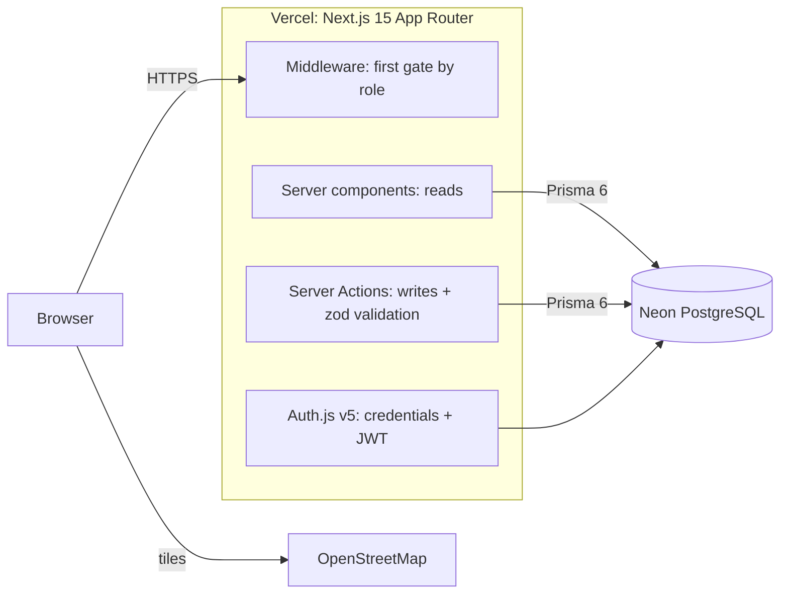
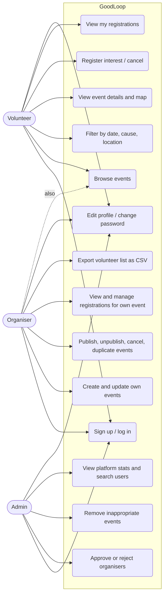
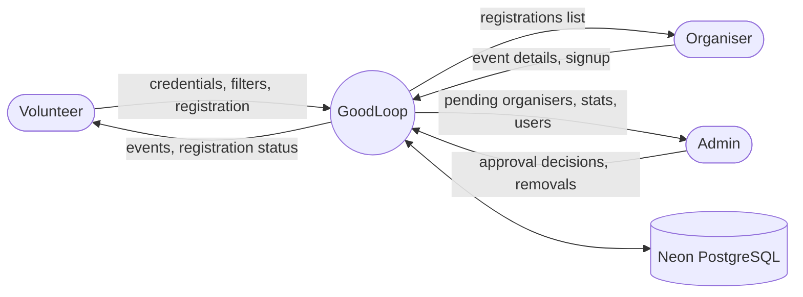
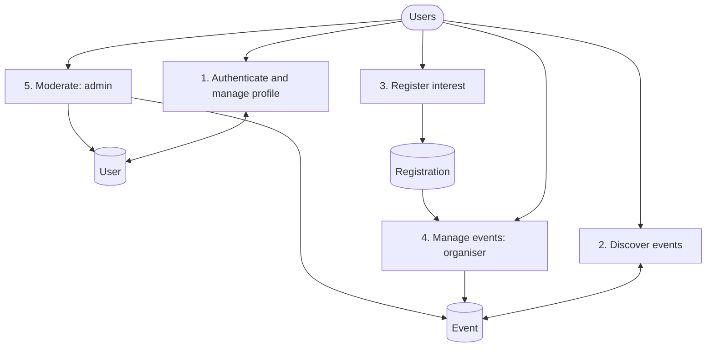
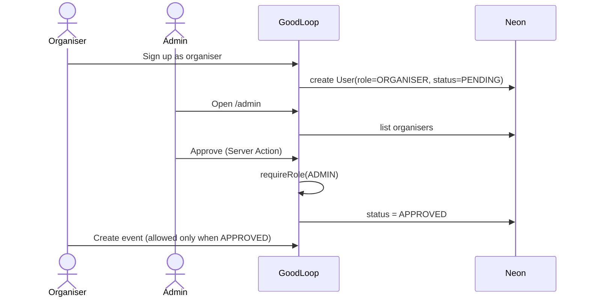
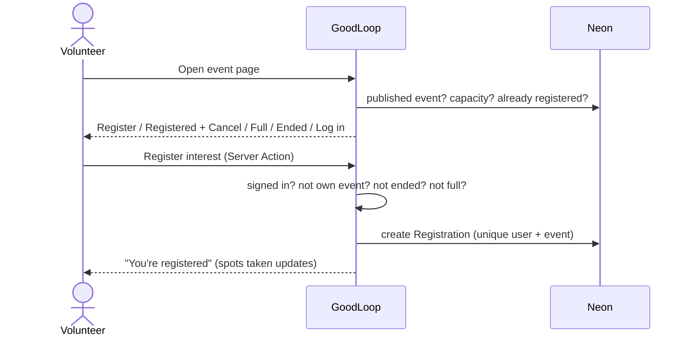
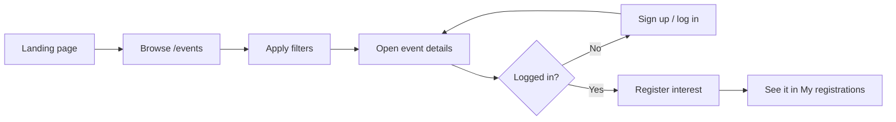
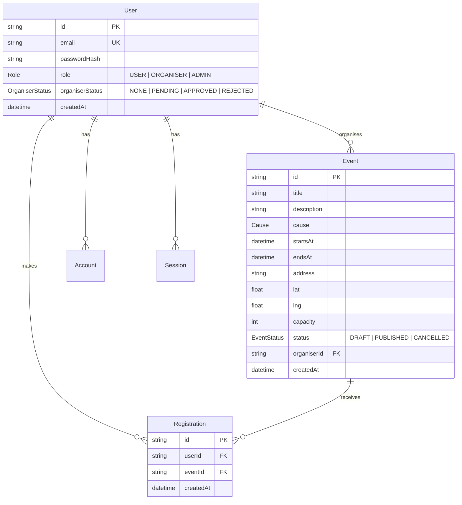

# GoodLoop: Mid-Evaluation Project Report

**Course:** CSET400C Capstone  
**Team:** Saransh (setup, auth, admin, deployment, registrations, maps, design system) · Aditya (events, organiser side) · Anousha (discovery, event pages) · Samaksh (not contributing for now; his areas moved to Saransh)  
**Live prototype:** https://goodloop-pi.vercel.app  
**Repository:** https://github.com/Saransh-Jainbu/goodloop  
**Last updated:** 18 November 2026

---

## 1. Project overview

GoodLoop is a web platform, in the spirit of Luma but built for **social good**, where people discover and join local volunteering and welfare activities. Think blood-donation camps, food-donation drives, clothes collection drives, clean-ups, teaching sessions and other community work. Organisers publish an event, volunteers find it by cause, date and place, say they are interested, and organisers see who is coming. Admins keep the platform trustworthy by approving organisers and removing inappropriate listings.

**Problem.** Local welfare drives are advertised through scattered chat groups and posters. Volunteers can't easily find them, and organisers can't tell how many people will show up.

**Goal of the MVP.** One place to find, filter and register interest in nearby volunteering events, with lightweight moderation. **The MVP is now functionally complete and live** (see §8).

**Next phase.** Having reached the MVP with time to spare, the team plans to grow GoodLoop into an *organisations platform*: organisations with public profiles that people can join, announcements from organisation admins, members-only chat, organisation-owned events and welfare drives with goals. The full plan is in `docs/PLAN_ORGANISATIONS.md`, tracked as epic #61 with 36 task issues in six milestones (§13.3).

> **Scope note for the evaluators.** The cause list in the database is `ENVIRONMENT, EDUCATION, HEALTH, COMMUNITY, ANIMALS, OTHER`. Blood donation maps to HEALTH, and food and clothes drives to COMMUNITY. Dedicated welfare categories and drive goals (e.g. 200 units of blood collected) are planned in the next phase (issue #93), not yet implemented.

---

## 2. Finalized system requirements

### 2.1 Stakeholders and roles

| Role | Description |
|---|---|
| **Volunteer** (`USER`) | Browses, filters and registers interest in events; manages their registrations and profile. |
| **Organiser** (`ORGANISER`) | Creates and manages their own events, reviews and manages registrations. Must be approved by an admin first. |
| **Admin** (`ADMIN`) | Approves or rejects organiser accounts, removes inappropriate events, and sees platform statistics and the user list. |

### 2.2 Functional requirements

| ID | Requirement | Owner | Status |
|---|---|---|---|
| FR1 | Browse opportunities and view event details | Anousha | **Done** (reads the database; only published events) |
| FR2 | Organisers create and update listings (title, description, date, location, cause) | Aditya | **Done** (PR #33, #58) |
| FR3 | Filter listings by date range, cause and location (in the URL) | Anousha | **Done** (tested against the database) |
| FR4 | Volunteers register interest; organisers review registrations | Saransh (volunteer side), Aditya (organiser view) | **Done**: register and cancel, `/me`, organiser roster. Two security fixes open (#98, #99) |
| FR5 | Admin reviews organiser accounts and removes listings | Saransh | **Done and verified**, plus stats and a searchable user list |
| FR6 | Sign-up, login, role-based access, profile (name, password) | Saransh | **Done and verified** |
| MAP | Events on an OpenStreetMap map; click-to-pin location picker | Saransh | **Built**; renders in the browser only (not yet verified visually, §9.3) |
| O4 | Lightweight relevance ordering of events (optional) | Saransh | Not started (#21) |

### 2.3 Non-functional requirements

| Area | Requirement |
|---|---|
| Security | Passwords hashed (bcrypt). Permissions enforced on the server, not only in the UI. Inputs validated with zod. Organisers may only modify their own events. |
| Usability | Responsive layout (mobile first), accessible navigation (skip link, labelled controls, reduced-motion respected). Empty, loading and error states handled. |
| Performance | Pages should respond in well under a second on a normal connection (§12). |
| Maintainability | One owner per file, small PRs, CI on every PR. |
| Deployability | `main` deploys automatically; the database schema is applied by committed migrations. |

### 2.4 Out of scope for the MVP, planned for the next phase
Organisations, memberships, announcements, chat, notifications and welfare drive goals (see `docs/PLAN_ORGANISATIONS.md`). Still out of scope: payments, recurring events, ratings and an advanced recommendation engine.

---

## 3. System architecture and design

GoodLoop is a single Next.js application. There is no separate backend. Server components read data, Server Actions perform writes, and everything talks to one PostgreSQL database.

**Key design decisions**
- **Server-side authorization.** Middleware redirects early, but every Server Action re-checks the role (`requireRole`, `requireApprovedOrganiser`) and ownership, so a forged request can't bypass the UI.
- **JWT sessions** carry the user's id and role, so role checks don't need a database round trip. The navbar reads the user's name from the database so profile edits show immediately.
- **Pooled vs direct connections.** The app uses Neon's pooled connection; migrations use the direct one.
- **Filters live in URL search params,** so any search is a shareable link.
- **Public discovery only shows published events,** so drafts and cancelled events stay hidden.
- **Maps load only in the browser** (Leaflet via `next/dynamic` with SSR off).
- **Contracts between modules** (fixed function signatures and exported components) let several people build in parallel.

---

## 4. Use-case, UML, DFD and flow diagrams

### 4.1 Use-case diagram

### 4.2 Data-flow diagram, level 0 (context)

### 4.3 Data-flow diagram, level 1

### 4.4 Sequence diagram: organiser approval (implemented)

### 4.5 Sequence diagram: register interest (implemented)

### 4.6 Flow diagram: volunteer journey

---

## 5. Database and data design

The database is PostgreSQL on **Neon**, accessed through **Prisma 6** with a multi-file schema (`prisma/schema/`), one file per area.

- **Integrity:** `Registration` has a unique pair `(userId, eventId)`, so nobody registers twice. Deleting a user or event cascades to their registrations. Cancelling a registration deletes the row.
- **Migrations:** two migrations are applied to production, `init` and `event` (the second was written to be safe on tables that already have rows). Schema changes are committed as migration folders and applied with `prisma migrate deploy` on each production deploy.
- **Seed data:** one admin, one demo organiser, and 8 demo events covering blood donation, food and clothes drives, a river clean-up, tutoring, animal care, tree planting and a senior health check-up. The seed is idempotent (safe to re-run) and every demo description is marked "(Demo listing)".
- **Planned (next phase):** organisations, memberships, invites, announcements, messages, notifications, reports and an audit log, all additive. The planned data model is in `docs/PLAN_ORGANISATIONS.md`.

---

## 6. Module and component design

| Module | Path | Responsibility |
|---|---|---|
| Auth and profile | `src/features/auth`, `src/lib/auth*.ts`, `src/app/me/profile` | Sign-up and login, Auth.js config, JWT with role; profile page to edit name and change password |
| Session helpers | `src/lib/session.ts` | `getCurrentUser()`, `requireRole()`, `requireApprovedOrganiser()` |
| Route protection | `src/middleware.ts` | Redirects by role for `/admin`, `/organiser`, `/me` |
| Admin | `src/features/admin`, `src/app/admin` | Stats cards, organiser table (approve/reject), event table (remove), searchable user list |
| Discovery | `src/features/discovery`, `src/app/events` | `getEvents(filters)`, `getEventById(id)` (published events only), filter bar, event cards and list |
| Events and organiser area | `src/features/events`, `src/app/organiser` | `Event` type, `CAUSES`; create, update, delete, status, duplicate; dashboard with stats; registrations page and CSV export |
| Registrations | `src/features/registrations`, `src/app/me` | `registerInterest`, `cancelRegistration`, `<RegisterButton>`, `getRegistrationsForEvent`, `getMyRegistrations`, My registrations page |
| Map | `src/features/map` | `<EventsMap>` with marker popups and `<LocationPicker>` click-to-pin (Leaflet, browser only) |
| Landing | `src/components/landing` | Hero with WebGL shader, features, how it works, trust, call to action |
| Design system | `src/app/globals.css`, `src/components` | Theme and fonts, sticky navbar with mobile and user menus, logo and favicon, 404/error/loading pages, buttons, cards, inputs, badge, skeleton, textarea |

**Contracts.** Each owner exports fixed signatures (e.g. `getEvents(filters)`, `<RegisterButton eventId />`) so modules plug together; owners can replace internals without breaking others.

---

## 7. Technology implementation

| Layer | Technology |
|---|---|
| Framework | Next.js 15 (App Router) + TypeScript |
| UI | Tailwind CSS 3, shadcn/ui, lucide icons, Inter and Plus Jakarta Sans (`next/font`), raw WebGL shader on the landing page |
| Database | PostgreSQL on Neon, Prisma 6 |
| Auth | Auth.js v5, credentials provider, JWT sessions, bcrypt |
| Validation | zod (every Server Action) |
| Maps | Leaflet + react-leaflet + OpenStreetMap tiles |
| Dates | date-fns |
| Hosting | Vercel (auto-deploy from `main`, preview deployments per PR; the repository is public) |
| CI | GitHub Actions: prisma validate, lint, typecheck, build |
| Package manager | pnpm |

**Engineering process.** Branch per task, PRs into `main` only, squash merge, branch protection (1 approval, code-owner review, required CI check), CODEOWNERS per area, a PR template with a checklist, and code review of teammates' PRs (with Copilot reviews). Work is tracked in GitHub issues and milestones.

---

## 8. Working MVP and prototype

The prototype is **live** at https://goodloop-pi.vercel.app, connected to the production Neon database. Every merge to `main` deploys automatically; the latest production deploy is healthy.

**Working now**
- **Landing page** explaining the product, with an animated shader hero.
- **Accounts:** sign-up (volunteer or organiser), login with role-based redirects, organisers start `PENDING`, and a profile page to edit your name and change your password.
- **Discovery** (`/events`): events read from the database, filters (cause, date range, location) in the URL, event detail pages, a real **map** with marker popups, empty, loading and error states. Drafts and cancelled events are hidden.
- **Registration:** a Register button on each event that shows the right state (log in, register, registered with Cancel, full, ended, you organise this). Spots taken are shown. `/me` lists upcoming and past registrations with cancel.
- **Organiser area:** dashboard with stats, create and edit forms with a click-to-pin map, publish, unpublish, cancel and duplicate events, delete with confirmation, a per-event volunteer roster with CSV export, and clear pending and rejected screens.
- **Admin panel** (`/admin`): platform stats, approve or reject organisers, remove events, and a searchable user list.
- **Design system:** new theme, sticky navbar with a mobile menu and user menu, logo and favicon, styled login and sign-up, and 404, error and loading pages.
- **Seeded demo data** (8 events) and a production deploy with both migrations applied.

**Known gaps**
- Two security fixes from code review are open: #98 (an organiser could delete another event's registration) and #99 (CSV export is open to spreadsheet formula injection). Both are assigned to Aditya.
- Unknown URLs show a "not found" page but return HTTP 200 instead of 404 on event pages (§9.2).
- The default seeded passwords still work on the public site (§11).
- Several visuals (map rendering, mobile layouts, the redesign) have not been checked in a browser by the author of this report (§9.3).

---

## 9. Test cases and initial validation

There is **no automated test suite in the repository yet** (issue #63 sets one up). Validation so far is CI checks plus scripted end-to-end checks run against the real Neon database and the live deployment. The scripts were throwaway and are not committed; converting them into automated tests is the first task of the next phase.

### 9.1 Automated checks (every PR)
`prisma validate` · ESLint · TypeScript typecheck · `next build`. All pass on `main`. Pull requests also get a Vercel preview build.

### 9.2 Scripted end-to-end results

| Suite | Where | Result | What it covered |
|---|---|---|---|
| Core flows | Live site | **54 of 55 passed** | Public pages, filters, anonymous redirects, seeded logins, wrong password, signup (volunteer and organiser, duplicates, short password), role access, pending organiser blocked, admin approval, organiser create, edit, delete, ownership of other organisers' events (replayed actions denied), status kept on edit, admin removing an event |
| Registration and maps | Local, real database | **25 of 25** | Register, double registration, `/me`, organiser roster visibility, another user cannot cancel, organiser cannot register for own event, full event, ended event, draft hidden, map placeholders render |
| Discovery from the database | Local, real database | **7 of 7** plus leak checks | Only published events listed; cause, location, from, to and date-range filters; empty state; published detail opens; draft and cancelled pages leak no title, description or address |
| Admin stats and profile | Local, real database | **20 of 20** | Stat cards match database counts; user search; non-admins blocked; profile name update; wrong, mismatched, too-short and reused passwords rejected; a valid change logs in with the new password and not the old |
| Navbar and design | Local | **10 of 10** | Logged-out, admin and organiser navbar, sticky and blur, mobile menu button, skip link, active link, favicon, custom 404 |
| Registration smoke | Local, after redesign | **6 of 6** | Register, registered state, `/me`, cancel still work with the restyled components |

More than 120 checks passed in total. **One failing check:** an unknown event id shows the "not found" page but returns HTTP 200, not 404 (the page streams before the not-found is raised). It is cosmetic and low priority.

All test data was deleted after each run. Two of the early scripts had setup bugs of their own, which were found and fixed before the numbers above were taken.

### 9.3 Defects and findings from validation and code review

| Finding | Where found | Status |
|---|---|---|
| Empty `AUTH_SECRET` caused a 500 on every auth call | Validation | Fixed (configuration) |
| Malformed `AUTH_URL` on Vercel broke the whole site | Validation | Fixed (configuration) |
| Editing a draft or cancelled event silently republished it | Review of PR #33 | Fixed |
| Migration added required columns without defaults, unsafe on non-empty tables | Review of PR #33 (and Copilot) | Fixed |
| Teammates' commits blocked from deploying (private repository on a free plan) | Merge of PR #33 | Fixed by making the repository public |
| `declineRegistration` deletes by id without checking the event | Review of PR #58 | **Open (#98)** |
| CSV export vulnerable to formula injection | Review of PR #58 | **Open (#99)** |

### 9.4 Not yet tested
Map and location-picker behavior in a real browser (only the server-rendered placeholder and the build were checked), mobile devices and layouts, the visual result of the redesign, the organiser CSV export itself, behavior under many concurrent users (capacity is checked just before inserting, so two simultaneous registrations could exceed capacity by one), and time-zone handling of event times.

---

## 10. User and stakeholder feedback

**Not collected yet.** The product has not been put in front of real volunteers or organisers. Planned before the final evaluation:
- a short walkthrough with 5 to 8 volunteers (students and local NGO contacts) using a task script (find an event, filter it, register);
- one organiser interview about how they run blood-donation or food-drive sign-ups today and what an organisation-based platform would need;
- a short feedback form (ease of use, missing features), with results summarised in the final report.

Feedback will also be used to confirm which phases of the organisations plan matter most.

---

## 11. Updated risk analysis

| Risk | Likelihood | Impact | Mitigation / status |
|---|---|---|---|
| Default seeded passwords on a public site and public README | **High** | High | **Open.** Must be reset before real users; the README should stop listing them (#18) |
| Open security findings (#98, #99) already merged to production | Medium | Medium to high | Assigned to Aditya; both are small fixes. Hard to exploit today, but should be fixed promptly |
| Local development and testing ran against the production database (no separate dev branch yet) | Medium | High | Create a Neon dev and test branch before the next phase; tests must refuse to run against production (#63) |
| Secret leakage (a database password was pasted into chat during setup) | Medium | High | Rotate credentials; never commit `.env*` (the repository history was scanned and is clean) |
| No automated tests, so regressions are possible | Medium | Medium | Test setup and permission tests are the first tasks of the next phase (#63, #65) |
| Misconfigured environment variables break production | Medium | High | **Occurred twice.** `.env.example` documents them; verify the live site after each env change |
| Scope growth (organisations, chat) | Medium | Medium | Plan is phased so each phase is demoable; scope needs team sign-off (#62); there is plenty of time before the final evaluation |
| A team member is not contributing | Medium | Medium | Samaksh's areas were reassigned and are now built; issue owners can be rebalanced |
| Chat abuse and spam (next phase) | Medium | High | Organisation verification, membership-only chat, rate limits, moderation, reports (phases 3 and 4) |
| Fake or abusive listings | Medium | High | Admin approval of organisers; admin removal of events |
| Unauthorized access to organiser or admin actions | Low | High | Role and ownership checks on the server for every action; replayed-request tests |
| Free-tier limits (Neon, Vercel) | Low | Medium | Usage is low; monitor |

---

## 12. Performance and accuracy results

Measured with `curl` against the live site on 18 November 2026, from one location, three samples each. They are indicative only and not a load test.

| Page | Status | Time to first byte | Total time | Size |
|---|---|---|---|---|
| `/` (landing) | 200 | 0.62 to 0.97 s | 0.63 to 1.16 s | 103 KB |
| `/events` (8 events) | 200 | 0.55 to 0.67 s | 0.57 to 0.87 s | 61 KB |
| `/events/<id>` | 200 | 0.33 to 0.41 s | 0.39 to 0.53 s | 24 KB |
| `/login` | 200 | 0.35 to 0.37 s | 0.36 to 0.37 s | 18 KB |
| `/signup` | 200 | 0.35 to 0.40 s | 0.35 to 0.40 s | 19 KB |

- The landing page is the slowest and largest page, at about 0.6 to 1.0 s for the first byte. The events page now queries the database, which adds some time compared with the earlier sample-data version. A first request after a quiet period can be slower because of serverless cold starts.
- The landing shader renders at half resolution, pauses when off-screen, and shows a static frame for visitors who prefer reduced motion.
- Accuracy measures don't apply yet, because there is no ranking or ML component. If the O4 relevance ordering is built, it will be evaluated against a small hand-labelled set.
- **Not yet measured:** database query latency under load, Lighthouse scores, and real-device performance. These are planned for the final evaluation.

---

## 13. Statement of work

### 13.1 Completed
- Repository, CI, PR template, CODEOWNERS, branch protection on `main`, public repository.
- Next.js app with layout, role-based middleware, shared UI kit and design system.
- Neon database, Prisma schema, **two migrations applied**, idempotent seed with demo events.
- Auth: sign-up and login with roles and organiser status; profile page (name, password). Verified end to end.
- **Admin panel (FR5):** approve and reject organisers, remove events, platform stats, user list with search.
- **Discovery (FR1, FR3):** event cards, filters in the URL, list and detail pages, reading the database (published only), with empty, loading and error states.
- **Registration (FR4):** register and cancel, capacity, ended and own-event rules, `/me`.
- **Organiser area (FR2, FR4):** create, edit, status, duplicate, delete, dashboard with stats, roster with CSV export, pending and rejected screens.
- **Maps:** real events map with popups; click-to-pin location picker.
- **Landing page** and **design refresh** (theme, navbar, logo, favicon, auth pages, 404, error and loading pages).
- **Production deployment** on Vercel with automatic deploys, tested end to end on the live URL.
- **Organisations plan** and 36 task issues with acceptance criteria.
- 13 pull requests merged through CI (10 by Saransh, 2 by Aditya, 1 by Anousha), with written code reviews on two teammates' PRs (#33 and #58) that found and fixed real defects.

### 13.2 Remaining for the final evaluation (MVP follow-ups)

| Item | Issue | Owner |
|---|---|---|
| Fix `declineRegistration` ownership check | #98 | Aditya |
| Fix CSV formula injection | #99 | Aditya |
| Reset default seeded passwords; remove credentials from the README | #18 | Saransh |
| Final README pass; close the foundation issue | #18, #1 | Saransh |
| Relevance ordering `rankEvents` (optional) | #21 | Saransh |
| Accessibility and consistency pass | #45 | Saransh |
| Visual verification of the landing page, maps and `/me` against their issues | #38, #40, #42 | Saransh |
| Not-found pages return HTTP 404 instead of 200 | new | Anousha |
| Create a Neon dev and test branch; rotate database credentials | new | Saransh |
| Automated tests (actions, queries, permission checks) | #63 | Saransh |
| User feedback sessions and results (§10); performance measurements (§12) | new | Team |
| Screenshots and demo evidence (§14) | new | Team |

### 13.3 Next phase: organisations platform

Defined in `docs/PLAN_ORGANISATIONS.md` and tracked as epic #61. Each phase can be demonstrated on its own.

| Phase | Deliverable | Issues |
|---|---|---|
| 0 | Team sign-off on scope; automated test setup | #62, #63 |
| 1 | Organisations and membership: create, profile, directory, join and request, invites, roles, member management, org-owned events, migration of existing data | #64 to #76 |
| 2 | Announcements, member feed, notifications | #77 to #81 |
| 3 | Members-only chat with moderation, limits and unread counts (polling transport) | #82 to #87 |
| 4 | Organisation verification, reports queue, audit log, privacy, accessibility pass | #88 to #92 |
| 5 | Welfare extras: drives with goals, volunteer hours, email, analytics, documentation | #93 to #97 |

The plan includes the role and permission matrix, the data model, and the chat-transport decision (polling now, because serverless hosting cannot hold WebSocket connections).

---

## 14. Screenshots and demo evidence

> *Add screenshots before submission (each should be a real capture from the live site):*

| # | Screenshot | Where to capture |
|---|---|---|
| 1 | Landing page (hero and features) | https://goodloop-pi.vercel.app |
| 2 | `/events` with filters applied and the map | `/events?cause=ENVIRONMENT` |
| 3 | Event detail page with Register button and map | `/events/<id>` |
| 4 | Sign-up and login pages | `/signup`, `/login` |
| 5 | Navbar: desktop user menu and mobile menu | any page, logged in |
| 6 | My registrations and Profile | `/me`, `/me/profile` |
| 7 | Organiser dashboard with stats and event cards | `/organiser` (logged in as organiser) |
| 8 | Create event form with the map pin | `/organiser/new` |
| 9 | Volunteer roster with CSV export | `/organiser/<id>/registrations` |
| 10 | Admin panel: stats, pending organiser, user search | `/admin` (logged in as admin) |
| 11 | Green CI check on a PR, and the Vercel "Ready" deployment | GitHub PR page, Vercel dashboard |
| 12 | Neon tables (User, Event, Registration) | Neon console → Tables |
| 13 | GitHub issues board for the organisations epic | https://github.com/Saransh-Jainbu/goodloop/issues/61 |

**Demo script (5 minutes):** landing page → sign up as a volunteer and register for an event → see it in My registrations → log in as the organiser, publish an event and view the roster → log in as admin, approve an organiser and view stats → show the organisations plan.

**Evidence available now:** live URL, GitHub repository with PR history, reviews and green CI runs, the issue board and milestones, the scripted test results in §9, and the organisations plan.
