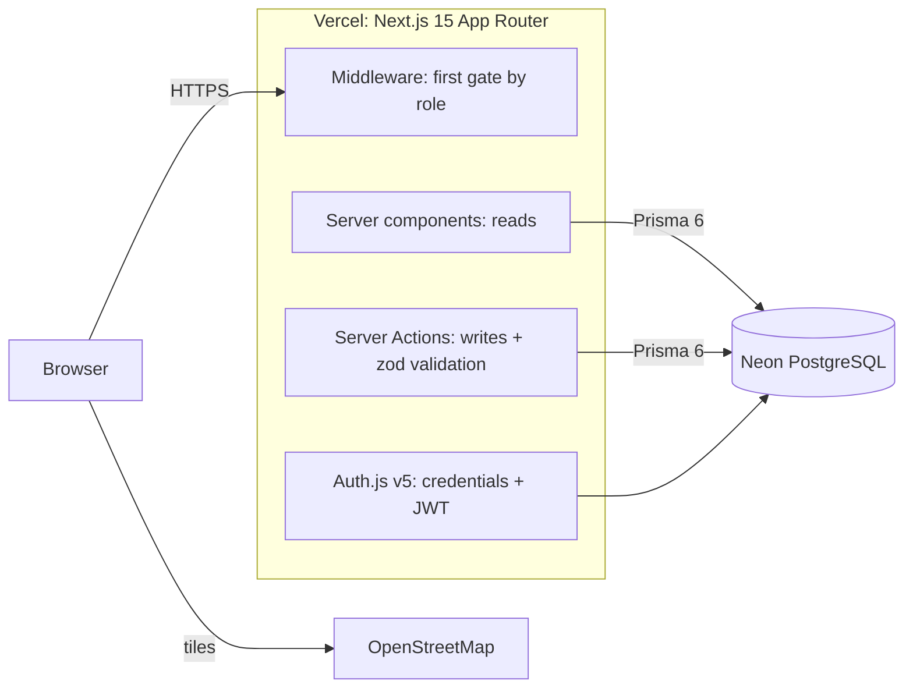
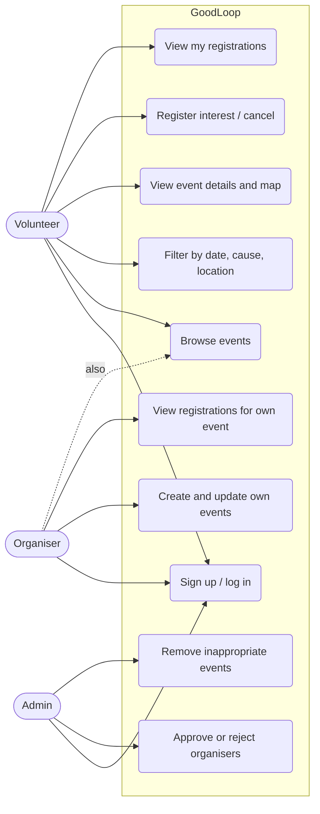
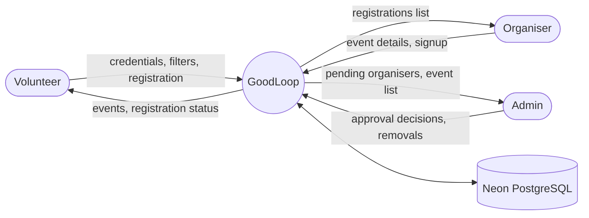
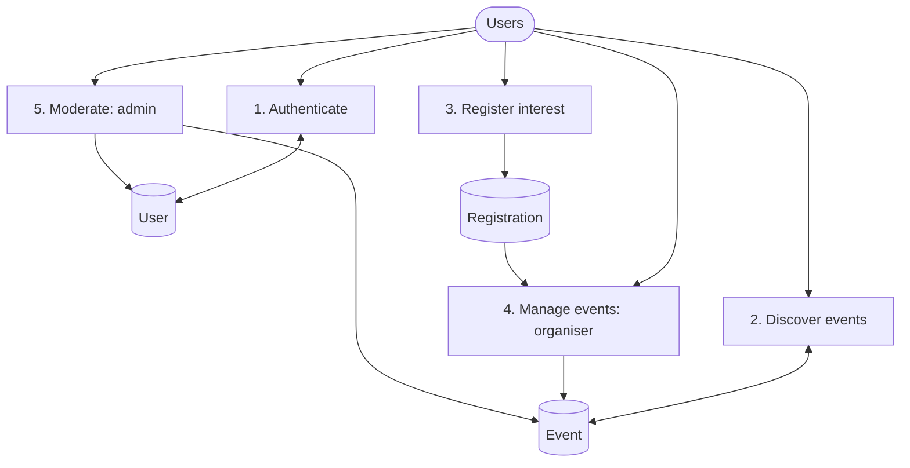
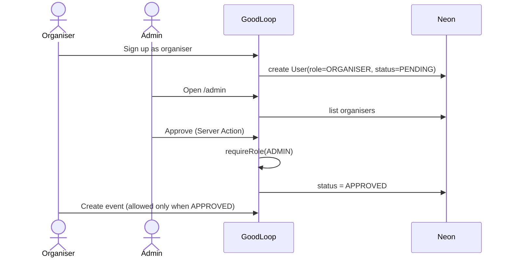
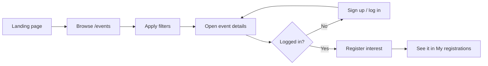
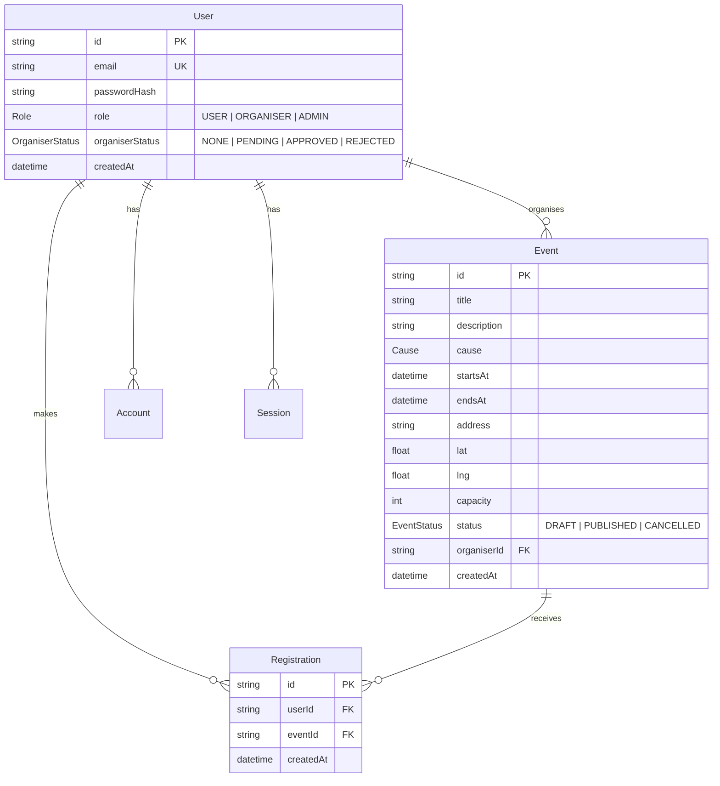

# GoodLoop: Mid-Evaluation Project Report

**Course:** CSET400C Capstone  
**Team:** Saransh (setup, auth, admin, deployment) · Aditya (events, organiser side) · Samaksh (registrations, map) · Anousha (discovery, event pages)  
**Live prototype:** https://goodloop-pi.vercel.app  
**Repository:** https://github.com/Saransh-Jainbu/goodloop

---

## 1. Project overview

GoodLoop is a web platform, in the spirit of Luma but built for **social good**, where people discover and join local volunteering and welfare activities. Think blood-donation camps, food-donation drives, clothes collection drives, clean-ups, teaching sessions and other community work. Organisers publish an event, volunteers find it by cause, date and place, say they are interested, and organisers see who is coming. Admins keep the platform trustworthy by approving organisers and removing inappropriate listings.

**Problem.** Local welfare drives are advertised through scattered chat groups and posters. Volunteers can't easily find them, and organisers can't tell how many people will show up.

**Goal of the MVP.** One place to find, filter and register interest in nearby volunteering events, with lightweight moderation. The MVP is deliberately small.

> **Scope note for the evaluators.** The current cause list in the database model is `ENVIRONMENT, EDUCATION, HEALTH, COMMUNITY, ANIMALS, OTHER`. Blood donation maps to HEALTH, and food and clothes drives to COMMUNITY. Dedicated categories (e.g. BLOOD_DONATION, FOOD, CLOTHES) are a planned refinement, not yet implemented (see §13).

---

## 2. Finalized system requirements

### 2.1 Stakeholders and roles

| Role | Description |
|---|---|
| **Volunteer** (`USER`) | Browses, filters and registers interest in events. |
| **Organiser** (`ORGANISER`) | Creates and manages their own events, reviews registrations. Must be approved by an admin first. |
| **Admin** (`ADMIN`) | Approves or rejects organiser accounts and removes inappropriate events. |

### 2.2 Functional requirements

| ID | Requirement | Owner | Status |
|---|---|---|---|
| FR1 | Browse opportunities and view event details | Anousha | Built (on sample data) |
| FR2 | Organisers create and update listings (title, description, date, location, cause) | Aditya | Built (PR #33); needs integration testing |
| FR3 | Filter listings by date range, cause and location (in the URL) | Anousha | Built (on sample data) |
| FR4 | Volunteers register interest; organisers review registrations | Samaksh / Aditya | Organiser roster page built; volunteer registration and data layer in progress |
| FR5 | Admin reviews organiser accounts and removes listings | Saransh | **Done and verified** |
| FR6 | Sign-up, login and role-based access | Saransh | **Done and verified** |
| O4 | Lightweight relevance ordering of events (optional) | Samaksh | Planned |
| MAP | Events shown on an OpenStreetMap map; location picker for organisers | Samaksh | In progress |

### 2.3 Non-functional requirements

| Area | Requirement |
|---|---|
| Security | Passwords hashed (bcrypt). Permissions enforced on the server, not only in the UI. Inputs validated with zod. Organisers may only modify their own events. |
| Usability | Responsive layout (mobile first). Empty, loading and error states handled. |
| Performance | Pages should respond in well under a second on a normal connection. |
| Maintainability | One owner per file, small PRs, CI on every PR. |
| Deployability | `main` deploys automatically; the database schema is applied by committed migrations. |

### 2.4 Out of scope (kept out on purpose)
Payments, chat, push notifications, recurring events, ratings and an advanced recommendation engine.

---

## 3. System architecture and design

GoodLoop is a single Next.js application. There is no separate backend. Server components read data, Server Actions perform writes, and everything talks to one PostgreSQL database.

**Key design decisions**
- **Server-side authorization.** Middleware redirects early, but every Server Action re-checks the role (`requireRole`, `requireApprovedOrganiser`) so a forged request can't bypass the UI.
- **JWT sessions** carry the user's id and role, so role checks don't need a database round trip.
- **Pooled vs direct connections.** The app uses Neon's pooled connection; migrations use the direct one.
- **Filters live in URL search params,** so any search is a shareable link.
- **Contracts between modules** (fixed function signatures and exported components) let four people build in parallel against stubs.

---

## 4. Use-case, UML, DFD and flow diagrams

### 4.1 Use-case diagram

### 4.2 Data-flow diagram, level 0 (context)

### 4.3 Data-flow diagram, level 1

### 4.4 Sequence diagram: organiser approval (implemented)

### 4.5 Flow diagram: volunteer journey

---

## 5. Database and data design

The database is PostgreSQL on **Neon**, accessed through **Prisma 6** with a multi-file schema (`prisma/schema/`), one file per owner.

- **Integrity:** `Registration` has a unique pair `(userId, eventId)`, so nobody registers twice. Deleting a user or event cascades to their registrations.
- **Event model:** the full model (description, start and end time, address, latitude and longitude, capacity, status) was added in PR #33 with a migration written to be safe on tables that already have rows. It reaches the production database with the next production deploy.
- **Migrations:** schema changes are committed as migration folders and applied to production with `prisma migrate deploy` on each production deploy. The first migration (`init`) is in `main`.
- **Seed data:** one admin and one demo organiser (dev/demo only).

---

## 6. Module and component design

| Module | Path | Responsibility |
|---|---|---|
| Auth | `src/features/auth`, `src/lib/auth*.ts` | Sign-up and login forms and actions, Auth.js config, JWT with role |
| Session helpers | `src/lib/session.ts` | `getCurrentUser()`, `requireRole()`, `requireApprovedOrganiser()` |
| Route protection | `src/middleware.ts` | Redirects by role for `/admin`, `/organiser`, `/me` |
| Admin | `src/features/admin`, `src/app/admin` | Organiser table (approve/reject), event table (remove) |
| Discovery | `src/features/discovery`, `src/app/events` | `getEvents(filters)`, `getEventById(id)`, filter bar, event cards and list |
| Events (contract) | `src/features/events` | `Event` type, `CAUSES`; organiser create/update actions |
| Map | `src/features/map` | `<EventsMap>`, `<LocationPicker>` (Leaflet, client-only) |
| Registrations | `src/features/registrations` | `<RegisterButton>`, `getRegistrationsForEvent`, `getMyRegistrations` |
| Landing | `src/components/landing` | Hero with WebGL shader, features, how it works, trust, CTA |
| UI kit | `src/components/ui` | shadcn/ui primitives |

**Contracts.** Each owner exports fixed signatures (e.g. `getEvents(filters)`, `<RegisterButton eventId />`) so modules plug together; owners can replace internals without breaking others.

---

## 7. Technology implementation

| Layer | Technology |
|---|---|
| Framework | Next.js 15 (App Router) + TypeScript |
| UI | Tailwind CSS 3, shadcn/ui, lucide icons, raw WebGL shader on the landing page |
| Database | PostgreSQL on Neon, Prisma 6 |
| Auth | Auth.js v5, credentials provider, JWT sessions, bcrypt |
| Validation | zod (every Server Action) |
| Maps | Leaflet + react-leaflet + OpenStreetMap |
| Dates | date-fns |
| Hosting | Vercel (auto-deploy from `main`, preview deployments per PR) |
| CI | GitHub Actions: prisma validate, lint, typecheck, build |
| Package manager | pnpm |

**Engineering process.** Branch per task, PRs into `main` only, squash merge, branch protection (1 approval, code-owner review, required CI check), CODEOWNERS per area, and a PR template with a checklist.

---

## 8. Working MVP and prototype

The prototype is **live** at https://goodloop-pi.vercel.app and connected to the production Neon database.

**Working now**
- Landing page that explains the product.
- Sign-up (volunteer or organiser) and login, with role-based redirects.
- Organisers start as `PENDING`.
- **Admin panel** (`/admin`): approve or reject organisers, remove events.
- **Discovery** (`/events`): event list, filters (cause, date range, location) in the URL, event detail pages, with empty, loading and error states. Currently served from sample data.
- **Organiser area** (PR #33): dashboard of own events, create and edit forms with validation, delete with confirmation, status (published, draft, cancelled), and a per-event registrations page. All server actions check the organiser's ownership.
- Production deploy with the `init` migration applied. The `event` migration ships with the next production deploy.

**Still stubs or in progress:** registrations (volunteer side and the data behind the organiser roster), the real map and location picker, and switching discovery from sample data to the database (see §13).

---

## 9. Test cases and initial validation

There is **no automated test suite yet**. Validation so far is CI checks plus manual end-to-end tests run against the real Neon database, both locally and on the live deployment.

### 9.1 Automated checks (every PR)
`prisma validate` · ESLint · TypeScript typecheck · `next build`. All pass on `main`.

### 9.2 Manual test cases executed

| # | Test | Expected | Result |
|---|---|---|---|
| T1 | Admin logs in | Session role `ADMIN`; `/admin` opens | Pass |
| T2 | Organiser logs in | Role `ORGANISER`; `/organiser` opens | Pass |
| T3 | Wrong password | Login rejected, no session | Pass |
| T4 | Anonymous opens `/admin`, `/organiser`, `/me` | Redirect to `/login` | Pass |
| T5 | Volunteer opens `/organiser` or `/admin` | Redirect away | Pass |
| T6 | Organiser opens `/admin` | Redirect away | Pass |
| T7 | Sign up as volunteer | Account created, lands on `/events` | Pass |
| T8 | Sign up as organiser | Account created with status `PENDING`, role `ORGANISER` | Pass |
| T9 | Sign up with an existing email / a too-short password | Rejected with an error | Pass |
| T10 | Admin approves, rejects, re-approves an organiser | Status in DB changes each time | Pass |
| T11 | Admin removes an event | Event deleted from DB | Pass |
| T12 | **Non-admin submits the approve action directly** | Redirected; status unchanged (server-side check) | Pass |
| T13 | Same flows on the live Vercel site | Same results; redirects use the production domain | Pass |

**Defects found and fixed during validation:** (a) empty `AUTH_SECRET` caused a 500 on every auth call; (b) a malformed `AUTH_URL` on Vercel broke the whole site until corrected. Both were configuration errors, not code bugs.

### 9.3 Not yet tested
The organiser create, edit and delete flows from PR #33 (the author tested them; the team has not independently re-run them), pending organisers being blocked from creating listings in the UI, registration flows, map behavior, and mobile devices.

---

## 10. User and stakeholder feedback

**Not collected yet.** The product has not been put in front of real volunteers or organisers. Planned before the final evaluation:
- a short walkthrough with 5 to 8 volunteers (students and local NGO contacts) using a task script (find an event, filter it, register);
- one organiser interview about how they run blood-donation or food-drive sign-ups today;
- a short feedback form (ease of use, missing features), with results summarised in the final report.

---

## 11. Updated risk analysis

| Risk | Likelihood | Impact | Mitigation / status |
|---|---|---|---|
| Event and registration work is late, blocking integration | Medium | High | Stub exports and fake data let teams proceed; order of work is tracked in issues |
| Misconfigured environment variables break production | Medium | High | **Occurred twice** (`AUTH_SECRET`, `AUTH_URL`). `.env.example` documents them; verify the live site after each env change |
| Default seeded passwords on a public site | High | High | **Open.** Must be changed before real users |
| Secret leakage (a DB password was pasted into chat during setup) | Medium | High | Rotate credentials; never commit `.env*`; rotation recommended |
| Several developers sharing one database | Medium | Medium | One Neon branch per developer; migrations never run on production from feature branches |
| Fake or abusive listings | Medium | High | Admin approval of organisers; admin removal of events |
| Unauthorized access to organiser or admin actions | Low | High | Role checks on the server for every action, in addition to middleware |
| No automated tests, so regressions are possible | Medium | Medium | Add tests for actions and queries before final; CI already blocks broken builds |
| Scope creep (payments, chat, etc.) | Medium | Medium | MVP scope fixed in `CLAUDE.md`; extras deferred |
| Free-tier limits (Neon, Vercel) | Low | Medium | Usage is low; monitor |

---

## 12. Performance and accuracy results

Measured with `curl` against the live site, from one location, one sample each. They are indicative only and not a load test.

| Page | Status | Time to first byte | Total time | Size |
|---|---|---|---|---|
| `/` (landing) | 200 | 0.39 to 0.60 s | 0.60 to 0.90 s | 96 KB |
| `/events` | 200 | 0.40 s | 0.40 s | 36 KB |
| `/login` | 200 | 0.41 s | 0.41 s | 12 KB |

- The landing shader renders at half resolution and pauses when off-screen to limit GPU use, and it shows a static frame when the visitor prefers reduced motion.
- Accuracy measures don't apply yet, because there is no ranking or ML component. If the O4 relevance ordering is built, it will be evaluated against a small hand-labelled set.
- **Not yet measured:** database query latency under load and Lighthouse scores. These are planned for the final evaluation.

---

## 13. Statement of work

### 13.1 Completed
- Repository, CI, PR template, CODEOWNERS, branch protection on `main`.
- Next.js app with layout, navigation, role-based middleware, shared UI kit.
- Neon database, Prisma schema, **init migration applied**, seed script.
- Auth: sign-up and login with roles and organiser status. Verified end to end.
- **Admin panel (FR5):** approve and reject organisers, remove events.
- **Discovery UI (FR1, FR3):** event cards, filters in the URL, list and detail pages, empty, loading and error states (on sample data).
- **Organiser area and Event model (FR2, partly FR4):** PR #33, reviewed and merged.
- **Landing page** with animated hero, features, how it works and trust sections.
- **Production deployment** on Vercel, tested end to end on the live URL.

### 13.2 Remaining for the final evaluation

| Item | Issue | Owner |
|---|---|---|
| Location picker that works on a real map (currently a placeholder button) | #17 | Samaksh |
| Registrations data behind the organiser roster (`getRegistrationsForEvent`) | #17 | Samaksh |
| `Registration` model + migration, `RegisterButton`, register / cancel, `/me` page | #12, #13 | Samaksh |
| Map component with real markers (Leaflet + OpenStreetMap) | #4 | Samaksh |
| Switch discovery from sample data to real database queries | (follow-up to #9) | Anousha |
| Relevance ordering `rankEvents` (optional) | #21 | Samaksh |
| Seed sample events; final README | #18 | Saransh |
| **Welfare-specific categories** (blood donation, food, clothes, social work) and matching filters | new | Team |
| Automated tests (actions, queries, permission checks) | new | Team |
| Change default seeded passwords; rotate DB credentials | new | Saransh |
| User feedback sessions and results (§10); performance measurements (§12) | new | Team |
| Invite remaining collaborator; project-board setup | #24 | Saransh |

---

## 14. Screenshots and demo evidence

> *Add screenshots before submission (each should be a real capture from the live site):*

| # | Screenshot | Where to capture |
|---|---|---|
| 1 | Landing page (hero and features) | https://goodloop-pi.vercel.app |
| 2 | `/events` with filters applied | `/events?cause=ENVIRONMENT` |
| 3 | Event detail page | `/events/<id>` |
| 4 | Sign-up form (volunteer and organiser) | `/signup` |
| 5 | Admin panel with a pending organiser | `/admin` (logged in as admin) |
| 6 | Green CI check on a PR | GitHub PR page |
| 7 | Vercel deployment "Ready" | Vercel dashboard |
| 8 | Neon tables (User, Event, Registration) | Neon console → Tables |

**Demo script (3 minutes):** landing page → sign up as organiser → log in as admin and approve → browse and filter events as a volunteer → open an event.

**Evidence available now:** live URL, GitHub repository with PR history and green CI runs, issue board, and the manual test table in §9.
